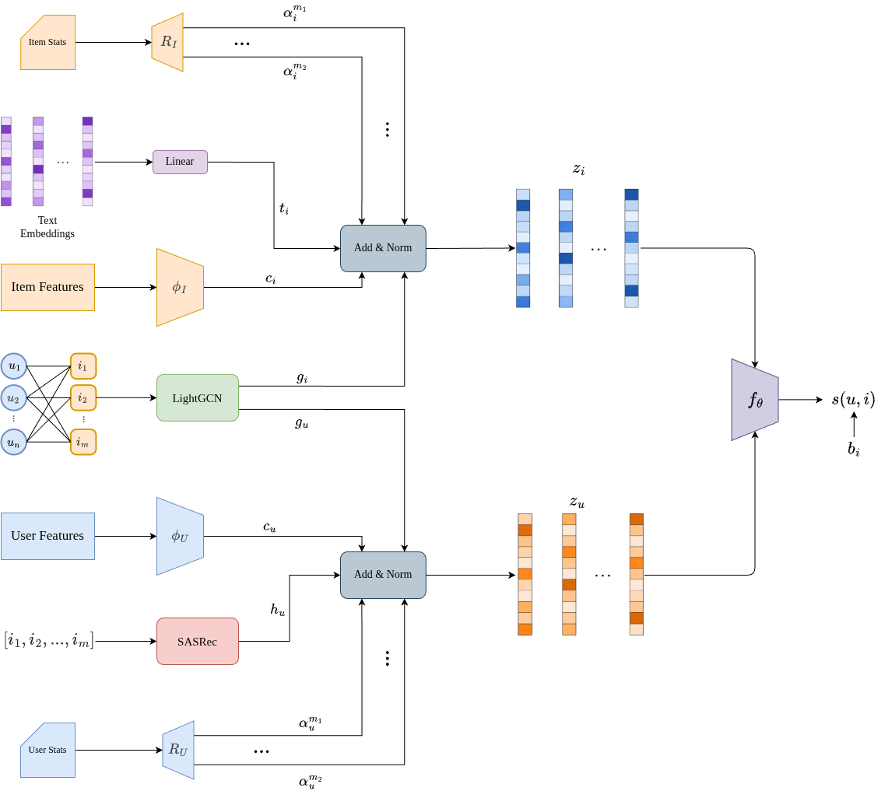

# EDuRec

EDuRec is a PyTorch Lightning recommendation system for e-learning datasets. It
combines a schema-derived knowledge graph, item text representations, and
sequential user history to recommend educational resources.

This repository is part of the Master's Thesis by Francisco de Paula Algar
Munoz at the Menendez Pelayo International University.

## Project Description

The project implements and evaluates a hybrid educational recommender for
implicit and explicit student-resource interactions. The codebase includes:

- Dataset loaders and preprocessing for `mars`, `itm`, and `doris`.
- The proposed EDuRec model, implemented with PyTorch, PyTorch Geometric, and
  Lightning.
- Training, testing, dataset inspection, hyperparameter optimization, benchmark
  evaluation, and ablation commands as plain Python scripts in `scripts/`.
- RecBole-based comparisons against classical and state-of-the-art recommenders.
- Ranking metrics at multiple cutoffs, including Precision, Recall, NDCG, Hit
  Rate, MAP, and MRR.

## Installation

The project uses Python 3.12 or newer and [`uv`](https://docs.astral.sh/uv/) for
dependency management.

```bash
git clone https://github.com/Pacatro/EDuRec.git
cd EDuRec
uv sync
```

For development dependencies such as `mlflow`, use:

```bash
uv sync --group dev
```

The repository expects raw datasets under `data/raw/<dataset>`. The included
loaders currently support:

- `data/raw/mars`
- `data/raw/itm`
- `data/raw/doris`
- `data/raw/mooccubex`
- `data/raw/coco`

MOOCCubeX recommends courses and connects them to fields, concepts, teachers,
and offering universities in the knowledge graph. The downloader fetches
`entities/user.json`, `entities/course.json`, `entities/concept.json`, `relations/concept-course.txt`,
`relations/course-teacher.txt`, and `relations/course-school.txt`, reusing files
already present. Memberships use original entity IDs, include reverse relations,
and are restricted to the retained course catalog. Concept, teacher, and school
IDs are graph-only attributes, avoiding dense concept feature matrices. Course
prerequisite descriptions are encoded as text rather than inferred course links.
Concept nodes combine a learned ID embedding with a trainable projection of
their name/context text embeddings, using the configured multilingual text
encoder. Only concepts linked to retained courses are encoded, once per concept.

### Data preprocessing and cache

Datasets retain all users and items after source cleaning and optional sparsity
filtering (`--remove-sparse`). Minimum interactions per user and item are read
from `edurec/settings.py`. An optional whole-user interaction budget
(`-i`/`--max-interactions`) selects users in a stable hash order until the requested
number of interactions is reached and drops the users left out of the static
catalog, so histories, temporal splits and `num_users` stay consistent. Data is then split into train, validation and test sets, with
preprocessing fitted on training data.

Processed data is written to `data/processed/<dataset>/` after every build and
replaces the previous folder. A `manifest.json` records the dataset, the
processing version, the full data configuration and the split seed.
`--use-processed` reuses that folder only when the configuration matches the
current options; otherwise the loader raises an actionable error, so rebuild
without the flag after changing any split or preprocessing option.
A temporal split does not depend on the seed, so the same cache can be reused
across training seeds; random splits must match the seed
they were built with. Folders written by an older version of the code may not
be readable; delete the folder and rebuild when the loader reports an
incompatible cache. Caches without a manifest are still loaded, with a warning
that compatibility cannot be verified.

The lightweight MOOCCubeX model configuration can be used with
`--configs-folder configs/small`.
MOOCCubeX applies source filters before enrollment histories are assembled:
courses must expose a video or exercise resource, placeholder/test courses are
removed by name, users without valid enrollments are dropped, and users with
more than `settings.MOOCCUBEX_MAX_USER_ENROLLMENTS` distinct courses are
excluded. The pipeline then keeps users and courses with at least
`settings.MOOCCUBEX_MIN_CONNECTIONS` connections (5 by default for this
dataset). Concept text can be disabled through
`settings.MOOCCUBEX_ENCODE_CONCEPT_TEXT`.

Missing metadata falls back to the name in the concept ID and emits a warning.
Embeddings and original IDs are saved with the processor; the KG exposes the
ID-to-row correspondence as `node_ids`. The `use_text_features` ablation also
disables concept text, including in contrastive graph views. Processed caches
from older versions are rebuilt automatically on the next run. Course-concept
links remain binary; video-based relevance weights require a separate extension.

Attribute text is also used by other datasets when their static metadata permits:

| Dataset | Graph text and entities |
| --- | --- |
| MARS (explicit and implicit) | Existing job, software, theme, resource type and difficulty nodes use their readable labels as text features. |
| DORIS | Course type and, when present in the course table, college/department nodes use their labels. Course names and prerequisite descriptions also enrich item text. |
| COCO | Category and instructional-level labels have text features. Course-instructor links retain instructor IDs; available name/profile fields enrich instructor nodes. Missing profiles keep their learned ID embedding with zero text features. |
| ITM | Item titles/descriptions remain item features; the source has no auxiliary item entities to enrich directly. |

The generic `graph_text` schema supports label text (`["name"]`) as well as
external entity tables. Scalar labels preserve commas; only list-valued fields
are split into memberships. Text vectors use retained item metadata exclusively,
respect `use_text_features`, and are stored with the processor. Course departments
are never inferred from enrollment rows, and instructor text excludes review and
enrollment statistics. These additions apply to the `kg_rnn` encoder; text-only
architectures continue to use item text.

## Usage

Each command is a Python script in `scripts/`. `--help` lists the options of
each one:

```bash
uv run scripts/train.py --help
```

Options shared by the training commands (`train`, `eval`, `hpo`, `ablation`):

```text
--device [auto|cpu|cuda]  Device to use
--verbose                 Verbose output
-h, --help                Show help
```

### Inspect a Dataset

Explore every dataset's KG with
[`notebooks/knowledge_graphs.ipynb`](notebooks/knowledge_graphs.ipynb):

```bash
uv run --with plotly --with jupyterlab jupyter lab notebooks/knowledge_graphs.ipynb
```

The notebook shows full-graph statistics, interactive sampled neighborhoods,
item search, entity/relation filters and a schema diagram. It exports standalone
HTML files to `results/knowledge_graphs/`. By default it uses a compatible cache
or local raw files and skips missing datasets. Raw mode inspects the original
catalog without generating text embeddings or overwriting training caches;
cache mode uses the retained training catalog and its saved features. Downloads
are opt-in through `ALLOW_DOWNLOAD`.

Print basic statistics and sample rows from a dataset.

```bash
uv run scripts/dataset.py --dataset explicit_mars --max-rows 10
```

Options:

```text
-d, --dataset [explicit_mars|implicit_mars|itm|doris|mooccubex|coco]  Dataset to use
-m, --max-rows INTEGER          Number of rows to show
-i, --max-interactions INTEGER  Optional whole-user interaction budget
```

### Train EDuRec

Train the proposed model on one dataset. If `--dataset` is omitted, the command
iterates through all registered datasets.

```bash
uv run scripts/train.py --dataset explicit_mars --use-processed --save-model
```

For a smaller MOOCCubeX run on a modest machine, cap the whole-user budget:

```bash
uv run scripts/train.py -d mooccubex --max-interactions 500000 --device cpu
```

Common options:

```text
-d, --dataset [explicit_mars|implicit_mars|itm|doris|mooccubex|coco]
-e, --epochs INTEGER            Default: from saved train config
-l, --lr FLOAT                  Default: from saved train config
-b, --batch-size INTEGER        Default: from saved train config
-p, --patience INTEGER          Default: from saved train config
--val-size FLOAT                Default: 0.1
--test-size FLOAT               Default: 0.2
-k, --top-k INTEGER             Default: 20
--remove-sparse / --no-remove-sparse  Remove sparse users/items (default: on)
-i, --max-interactions INTEGER  Optional whole-user interaction budget
-a, --adaptive-k               Use adaptive-k metrics where supported
-r, --random-state INTEGER      Seed for training and data splits
-D, --debug                     Fast debug run
-S, --save-model                Save checkpoint, config, and metrics
-P, --use-processed             Reuse data/processed/<dataset> only if its manifest matches
-M, --models-folder PATH        Default: models
-C, --configs-folder PATH       Default: configs
-N, --run-name TEXT             Optional MLflow run name
```

KGSeq supports optional graph contrastive learning (GCL). Recommendation uses
the complete knowledge graph; two independently edge-dropped views regularize
the same HGT encoder during training only. Each edge is removed together with
its explicit reverse relation. The objective is the existing weighted
recommendation loss plus `gcl_weight * gcl_loss` (symmetric item InfoNCE).

```bash
uv run scripts/train.py --device cpu --random-state 42 --dataset doris --arch kg_rnn --gcl-weight 0.01 --debug
```

Set these fields in `configs/kg_rnn-<dataset>.yaml`, or override
them with `--gcl-weight`, `--gcl-temperature`, `--gcl-edge-dropout`, and
`--gcl-max-items`:

```yaml
use_gcl: true
gcl_weight: 0.01
gcl_temperature: 0.2
gcl_edge_dropout: 0.1
gcl_max_items: 512
```

Set `use_gcl: false` to disable GCL while preserving its weight, temperature,
dropout, and anchor limit. Set it back to `true` to restore those settings.
The CLI flags `--gcl` / `--no-gcl` override the saved switch. A positive
`gcl_weight` is also required to run GCL.

GCL defaults to disabled (`gcl_weight: 0.0`) for compatibility with existing
experiments and checkpoints. Anchors are unique history items and training
targets, randomly capped by `gcl_max_items`; targets never enter the history
or graph structure. Training logs `train/rec_loss`, `train/gcl_loss`, and the
combined `train/Loss`. GCL adds two HGT passes per training batch; the anchor
cap bounds the contrastive matrix, not graph encoding. Validation and inference
use the complete graph and existing embedding cache. No data cache changes
are required. With `graph_mode: id`, GCL regularizes item representations
without structural augmentation.

### Evaluate EDuRec and Baseline Models

Run the proposed EDuRec model and baseline models on the selected dataset. If
`--dataset` is omitted, all datasets are evaluated.

```bash
uv run scripts/eval.py --dataset itm --use-processed --top-k 5 --top-k 10 --top-k 20
```

Default baseline models:

- `KGAN`
- `ItemKNN`
- `NeuMF`
- `LightGCN`
- `MultiVAE`
- `SGL`
- `SASRec`
- `BERT4Rec`

Useful options:

```text
-d, --dataset [explicit_mars|implicit_mars|itm|doris|mooccubex|coco]
-e, --epochs INTEGER            Default: from saved train config
-l, --lr FLOAT                  Default: from saved train config
-b, --batch-size INTEGER        Default: from saved train config
-p, --patience INTEGER          Default: from saved train config
-k, --top-k INTEGER             Repeat for multiple cutoffs
--remove-sparse / --no-remove-sparse
-i, --max-interactions INTEGER  Optional whole-user interaction budget
-P, --use-processed / --no-use-processed  Reuse data/processed/<dataset> when its manifest matches
-m, --baseline-model TEXT       Baseline to evaluate (repeat, or `all`)
-s, --seeds TEXT                Comma-separated seeds (default: 13,42,77)
-o, --output-dir PATH           Root folder for evaluation results
-C, --configs-folder PATH       Folder with saved configurations
-L, --logger                    Log the proposed model to MLflow
--only-proposed                 Evaluate only the proposed model
--only-baselines                Evaluate only the baseline models
-a, --adaptive-k / --fixed-k
```

Every model that is not the proposed one is a baseline. Baselines implemented
with PyTorch Lightning live under `edurec/evaluation/baselines/` (not through
RecBole); any other baseline name is passed to RecBole. Both kinds are scored
with the same shared full-catalog retrieval evaluator as EDuRec, so their
numbers are directly comparable.

```bash
uv run scripts/eval.py --dataset doris --use-processed --only-baselines --baseline-model all
```

KGAN is a standalone LightningModule with its own `kgan` data adapter. It
uses relation-grouped propagation memories, candidate-conditioned attention,
and the same query targets, catalog, history mask and metrics as other baselines.
Baseline parameters live in code; only the proposed model uses saved YAML
configurations. The defaults
come from paper sections 5.3/5.5.4, figure 3, and the
[official code](https://github.com/StZHY/KGAN/blob/041f80099ad5232fbb1b04fa0fcad47de4edc407/KGAN-master/src/main.py).

| Parameter | EDuRec default | Evidence |
| --- | --- | --- |
| Embedding dimension | 16 | Figure 3 peaks at 16; public code defaults to 32 |
| Propagation hops | 2 | Paper 5.3/5.5.4 and code |
| Memories per relation per hop | 32 | Paper 5.5.4 and code |
| KG loss weight | 0.01 | Code; paper gives a search range |
| L2 loss weight | 1e-6 | Code; paper gives a search range |
| Learning rate | 0.001 | Code; paper gives a search range |
| Batch size | 1024 | Paper 5.3 and code |
| Epoch budget | 20 | Code; not specified in the paper |
| Aggregate all hops | true | Equation 12 and code |
| Negatives per positive | 1 | Paper 5.1/4.3 |
| Optimizer / initialization | Adam / Xavier uniform | Paper 5.3 and code |

The paper searches learning rate and KG weight over
`[0.1, 0.05, 0.01, 0.005, 0.001]`, L2 weight over
`[1e-5, 5e-6, 1e-6, 5e-7, 1e-7]`, and dimension and memory size over
`[8, 16, 32, 64]`. It does not publish the final learning rate or loss weights
for each dataset, so the public code's defaults are used for those values.

Explicit CLI training options override the registered baseline defaults. KGAN does not inherit the proposed model's epochs,
learning rate or batch size. Ranking cutoffs, history policy and evaluation
seeds remain shared. The reference code seeds NumPy with 2020; EDuRec keeps
the requested experiment seeds. The number of relation groups is inferred
from the graph (the paper uses 7 in MOOCCube and 25 in BookCrossing).

Patience/checkpoint selection follows EDuRec's validation protocol; it is not
specified by the original training script. `candidate_chunk_size=64` is an
EDuRec memory-control setting. The reference attention code includes dropout
0.5, whereas equation 10 does not; the implemented equation-based attention
uses no dropout. All-hop aggregation is configurable through `using_all_hops`.
Entity/relation embeddings and attention linear layers use Xavier uniform
initialization, with zero attention biases.

```bash
uv run scripts/eval.py --dataset doris --only-baselines --baseline-model KGAN --baseline-model LightGCN
```

#### Adding a new baseline

Baselines are auto-discovered from `edurec/evaluation/baselines/`. To add one,
create a module in that folder and register a runner with the standard
signature; no changes to the CLI or the evaluation package are needed:

```python
# edurec/evaluation/baselines/my_model.py
from edurec.evaluation.baselines import register_baseline


@register_baseline("MyModel")
def eval_my_model(
    *,
    dm,
    train_cfg,
    val_topk,
    compile=False,
    verbose=False,
    run_name=None,
    experiment_name="TFM",
): ...  # return a one-row DataFrame whose "model" column is "MyModel"
```

It then runs with `uv run scripts/eval.py --baseline-model MyModel` (or via
`--baseline-model all`) and is saved next to EDuRec and the RecBole baseline
results.

Results are written to `results/evaluations/<dataset>/`, with one CSV per model
and seed, the detailed `evaluation_results.csv`, and the aggregated
`evaluation_summary.csv`.

### Optimize Hyperparameters

Run Optuna-based hyperparameter optimization for EDuRec.

```bash
uv run scripts/hpo.py --dataset explicit_mars --trials 30 --use-processed -L
```

The command saves the best model and training configurations, trial log, and
study database under `results/optimization/<dataset>/`. It also writes the best
configuration for each dataset and architecture to
`configs/<arch>-<dataset>.yaml`, using the same file names as
the copies under `results/optimization/`, so they can be reused by training and
evaluation. Use `--configs-folder` to choose a different folder.

To keep the search affordable, each trial trains for at most `--search-epochs`
epochs, validates on a fraction of the validation split, and a Hyperband pruner
stops underperforming trials early. The winning configuration is saved with the
full `--epochs` budget for the final run.

### Saved Configurations

The `configs/` folder keeps one configuration per dataset **and architecture**,
with model and training parameters grouped in separate mappings:

```yaml
# configs/kg_rnn-doris.yaml
arch: kg_rnn
model:
  emb_dim: 256
  # Remaining model parameters, including dataset dimensions.
train:
  epochs: 150
  lr: 0.0005
  batch_size: 128
```

`<arch>` can be `kg_rnn` or `sasrec_text`. When a config file exists for the
dataset and architecture being run, training, evaluation, and ablation commands
load it. Explicit CLI flags always take precedence over the saved
configurations, which in turn take precedence over the global defaults in
`edurec/settings.py`.

The scorer is always an MLP over `concat(user_state, candidate_item_embedding)`.
Feature modules are toggled with `use_item_features`, `use_user_features`,
`use_interaction_features`, `use_time_features`, `use_attention_pooling`,
`graph_mode`, and `use_text_features`.

### Run Ablations

Evaluate EDuRec variants across multiple random seeds.

```bash
uv run scripts/ablation.py --dataset doris --seeds 13,42,77,101,2026 --use-processed
```

Implemented main variants (all keep the item knowledge graph and the GRU):

- `item_kg`: item KG + GRU only.
- `item_kg_user`: adds the static user-profile initial state (`h0`).
- `item_kg_context`: adds the interaction context to each event.
- `item_kg_time`: adds the time-gap signal to each event.
- `full`: context + time + user profile (the default architecture).
- `attention_pooling`: `full` + optional attention pooling.
- `no_graph`: drops the knowledge-graph message passing, keeping only item ID
  embeddings and feature projections.
- `no_text`: removes the text embeddings from the item node features.
- `no_item_bias`: removes the learned item-popularity bias.

Variants that disable a module the dataset does not provide (for example
`no_text` on a dataset without text features) are marked as not applicable and
excluded from the plots. Aggregated outputs are saved to
`results/ablations/<dataset>/`.

## Model Architecture



EDuRec exposes `kg_rnn` through the `arch` field of the model configuration. It
refines item embeddings with a relation-aware item knowledge graph and encodes
each user's chronological history with a GRU/LSTM. Each historical event is the
sum of its item embedding, its interaction context and its time gap, the user
profile initialises the recurrent state, and an MLP scores user/candidate
pairs.

The sections below describe the modules.

The `sasrec_text` architecture implements a content-enhanced SASRec:
`course_emb = ID embedding + projected content features`. Content features reuse
the preprocessing pipeline's frozen pretrained text embeddings (text fields
are joined with their field names) and numeric course metadata. Both history
and candidates use the same course embedding table. A causal Transformer with
learned positions produces the user state from the last valid history position;
dot products with candidates produce scores for Top-K ranking. Graph, user
profile, attention pooling, and item bias are disabled for this architecture.
Empty histories produce a zero state and tied scores. If no content features
are available, the model uses course ID embeddings alone. Only `full` and
`no_text` (when text is available) apply in the ablation command.

```bash
uv run scripts/train.py --dataset doris --arch sasrec_text
```

Use the existing `transformer_hidden_dim`, `transformer_layers`,
`transformer_heads`, `max_history_len`, `emb_dim`, and `dropout` model settings.

- **Item knowledge graph encoder**: a heterogeneous item-only graph is derived
  from each dataset schema. Items are nodes, and every categorical or
  list-valued item field becomes an attribute node type. Relation direction is
  preserved: each forward edge type gets an explicit reverse edge type with a
  distinct `rev_` name (for example `ref::prerequisites` and
  `rev_ref::prerequisites`) instead of a blind symmetrisation. Extra relations
  are declared per dataset in the schema: `refs` links fields whose values name
  another entity (for example DORIS course prerequisites) and `cooc` links two
  attributes that co-occur in a row (for example COCO category levels). The
  graph is encoded by a stacked `HGTConv` (Heterogeneous Graph Transformer)
  with residual connections and LayerNorm; the number of layers, heads and
  dropout are configurable. Numeric and text embeddings initialise the item
  nodes.
- **Sequential encoder**: each history event is
  `LayerNorm(item_emb[t] + context[t] + time[t])`, where the interaction context
  comes from the preprocessed interaction features (rating, numeric,
  categorical, precomputed text embeddings) and the time signal is
  `Linear(log1p(delta_t))`. The static user profile is projected into the GRU's
  initial hidden state `h0`; the default user state is the last valid hidden
  state (attention pooling is an optional ablation). Missing signals are simply
  omitted.
- **Scorer**: an MLP over `concat(user_state, candidate_item_embedding)`. Full
  catalog scoring is chunked to bound memory. An optional item bias can be
  added.

### Leakage prevention

User-item interactions never enter the knowledge graph: `build_knowledge_graph`
does not accept interactions at all, so target/validation/test information
cannot leak into message passing. The item-item relations (`refs`, `cooc`) are
computed from static item metadata; if an interaction-derived relation (for
example item co-occurrence) is ever added it must be computed from the training
split only. Histories are built strictly chronologically and a row's own event
is never part of its own history (history, interaction context and timestamps
are aligned per step and only contain earlier events). Interaction features are
fitted on the training split by the tabular preprocessing functions.

Repeated `(user, item)` rows are preserved by default
(`deduplicate_interactions: false`) so real temporally-distinct events (view ->
progress -> complete) remain distinct. Datasets without a timestamp are always
deduplicated to avoid leakage across a random split; set
`deduplicate_interactions: true` to force deduplication.

Module availability is inferred from each processed dataset when the model
configuration is built. The knowledge graph automatically reflects the fields
declared by each dataset schema. Sequential history requires a real
chronological interaction field; datasets without one cannot train the model.

### Dataset package layout

```text
edurec/datasets/
├── __init__.py              # public data API
├── config.py                # processing options and cache manifest
├── cache.py                 # canonical ProcessedData and persistence
├── datamodule.py            # Lightning lifecycle and loaders
├── graphs.py                # reusable graph construction functions
├── queries.py               # history, context and negative sampling helpers
├── torch_data.py            # query samples and PyTorch dataset
├── sources/
│   ├── registry.py          # source contracts, names and registration
│   ├── common.py            # download/file helpers
│   └── <dataset>.py         # dataset-specific loading and schemas
├── preprocessing/
│   ├── build.py             # canonical processing pipeline
│   ├── prepare.py           # cleaning, deduplication and filtering
│   ├── splits.py            # temporal/random partitions
│   ├── ids.py               # canonical user/item identifiers
│   ├── lists.py             # list-valued feature normalization
│   ├── parsing.py           # feature value parsing
│   ├── tabular.py           # numeric and categorical encoding
│   └── text.py              # document and graph text embeddings
└── adapters/
    ├── base.py              # adapter contract, registration and selection
    ├── proposed.py          # proposed model structures and caching
    └── recbole.py           # RecBole inputs, atomic writers and ID conversion
```

Source loading feeds canonical preprocessing and caching. Model adapters then
consume `ProcessedData` and use shared builders or their own format writers
to assemble their inputs. `ElearningDataModule` connects
these stages to loaders. Shared imports such as `DataConfig`, `DatasetName`,
`ProcessedData`, `ProposedAdapter` and `RecSysQuery` are available from
`edurec.datasets`.

### Model data adapters

Preprocessing is coordinated by `datasets/preprocessing/build.py` using functions:
`encode_ids`, `normalize_lists`, `fit_tabular`, `transform_features`, and
`encode_graph_text`. IDs remain `int64`, and user/item row positions match their
canonical IDs. Numeric (`num__`), categorical (`cat__`), and text (`text__`)
columns have explicit prefixes. Dense tensors contain numeric columns followed
by text embeddings; categorical tensors contain integer codes with `-1` for
unknown values. Item lists stay as normalized tokens for knowledge-graph edges,
without allocating unused multi-hot matrices. Both table and graph text use
the same document encoder, with zero vectors for empty documents.

`ProcessedData` stores the resolved schema, original-to-canonical ID maps,
fitted sklearn transformers, and graph-node embeddings directly. Static
user/item transformers are fitted on the selected catalog, while interaction
transformers are fitted only on the training split. The preprocessing state is
saved in `preprocessing.joblib`; the v4 cache format replaces the former
`processor.joblib`. Rebuild older caches without `--use-processed`.

`ProcessedData` remains the canonical source of splits, labels and features.
Each `ModelDataAdapter` receives it directly and builds its model's structures.
`ProposedAdapter` builds and caches the item knowledge graph;
`RecBoleAdapter` builds the atomic files and converts queries to RecBole inputs.
The base class handles positive splits and the shared query protocol (histories,
interaction context and training negatives), all computed only when requested.
Reusable graph and query builders live in `graphs.py` and `queries.py`, with
PyTorch containers in `torch_data.py`. Adapters own the assembly and caching of
their model's structures. RecBole-specific file writers are private functions
in `adapters/recbole.py`, alongside the adapter that uses them.

```python
adapter = dm.adapter  # selected by adapter_name="proposed" by default
train_dataset = adapter.dataset("train")
proposed = dm.require_adapter(ProposedAdapter)
kg = proposed.knowledge_graph  # built once, from static item metadata
```

To add a structure, implement it in the corresponding adapter using
`self.data` or `self.relevant_splits`, optionally with `cached_property`.
Adding a baseline does not require adding methods to a shared facade. All
adapters read the same canonical data; switching models does not change caches.
The earlier `DataViews`/`DataAdapter` facade and `dm.views`/`dm.model_adapter`
accessors have been replaced by the single `dm.adapter` accessor.

### Adding a model data adapter

Implement `dataset(split)` and `evaluation_input(query)`. Use `prepare(stage)`
for additional structures when needed; repeated calls must be safe. The two
generic parameters describe the training sample and evaluation input types.
For example, a baseline that trains on positive user-item pairs can use:

```python
import torch
from torch.utils.data import TensorDataset

from edurec import settings
from edurec.datasets import ElearningDataModule, ModelDataAdapter, register_adapter


class PairAdapter(ModelDataAdapter[tuple[torch.Tensor, ...], torch.Tensor]):
    def dataset(self, split: str) -> TensorDataset:
        pairs = self.relevant_splits[split][
            [settings.USER_COL, settings.ITEM_COL]
        ].to_numpy(copy=True)
        return TensorDataset(torch.as_tensor(pairs, dtype=torch.long))

    def evaluation_input(self, query):
        return query.user_id


register_adapter("pair_baseline", PairAdapter)
dm = ElearningDataModule(config, batch_size=128, adapter_name="pair_baseline")
dm.setup("fit")
```

Register adapters before constructing/setting up the data module in each
process. Names must be unique. Factories accepting `(processed_data, query_config)` may
also be registered to provide model-specific options. An adapter can define a
`collate_fn` (use a static method for a function without `self`), set
`requires_temporal_order = True`, and inspect `metadata` for catalog sizes.
Use the existing transformation functions when applicable; model-specific
assembly belongs in the adapter. Treat processed data and cached structures as
read-only.

Training and checkpoint handling belong to the model integration. For ranking,
iterate `dm.evaluation_dataloader()` (or `adapter.evaluation_queries(split)`),
convert each batch with `evaluation_input`, and return scores of shape
`[batch, num_items]` in canonical item-ID order to the shared ranking metrics.
Model-specific train/validation/test loaders may use entirely different samples;
the evaluation loader always retains the canonical targets and histories.
Collaborative structures and fitted model transforms must use training only.
Never rebuild splits or include targets/future events in query inputs.

The RecBole runner selects a separate `recbole:ModelName` adapter for each
baseline. Its default `RecBoleAdapter` handles general/sequential export, data
configuration, internal ID mapping and query conversion. To customize one
baseline, subclass `edurec.datasets.adapters.recbole.RecBoleAdapter` and
register its exact name, for example `register_adapter("recbole:KGAT", KGATAdapter)`.
Override `export_files(output_dir)` for additional atomic files,
`configure(model, base)` for loaded fields, and `evaluation_input(query)` for
extra inputs. `export()` handles folder replacement; `bind_catalog()` and
`canonical_scores()` align RecBole IDs with the shared catalog. The generic
default handles general and sequential inputs; other model families require
these explicit extensions.

## Implemented Experiments

### Proposed Model Evaluation

`uv run scripts/eval.py` trains EDuRec, evaluates the best checkpoint on the test
split, and reports Precision, Recall, NDCG, Hit Rate, MAP, and MRR at the
configured top-k values.

### Baseline Benchmark Evaluation

The same evaluation command exports RecBole atomic files and runs the baseline
models with aligned split files, learning rate, epoch count, patience, batch
size, and top-k settings. Sequential baselines receive prebuilt histories for
the original train, validation, and test splits instead of asking RecBole to
split the merged interaction file again.

Final ranking metrics use one shared evaluator for every model. Each positive
test interaction is one query with one target, and EDuRec and the RecBole
baselines use the same full item catalog, seen-item mask, and TorchMetrics
implementations for Precision, Recall, NDCG, Hit Rate, MAP, and MRR.

### Hyperparameter Optimization

`uv run scripts/hpo.py -L` logs each trial as a separate run in the MLflow
experiment `HPO` (created if absent and reused across searches). Runs include
the study, dataset, trial number, sampled parameters, training metrics and
trial outcome (`COMPLETE`, `PRUNED`, or `FAIL`). Without `-L` / `--log-mlflow`,
HPO does not create MLflow runs.

`uv run scripts/hpo.py` runs Optuna studies for EDuRec and saves the best model
and training configurations as YAML for later training, evaluation, or ablation
experiments.

### Ablation Study

`uv run scripts/ablation.py` evaluates architecture variants across configurable
seeds and records metrics, parameter counts, and per-run configuration files.
This is intended to isolate the contribution of the knowledge-graph structure,
text features, item bias, and the scoring function.

## Author

[Francisco de Paula Algar Munoz](https://github.com/Pacatro)

## Advisors

Amelia Zafra Gomez

## License

This project is licensed under the MIT License. See [LICENSE](LICENSE) for
details.
